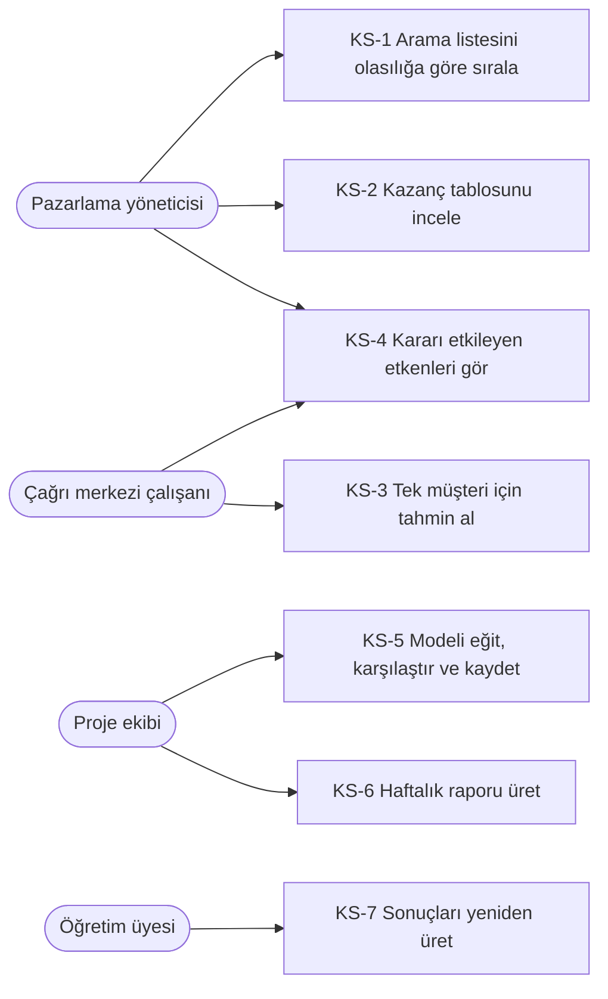
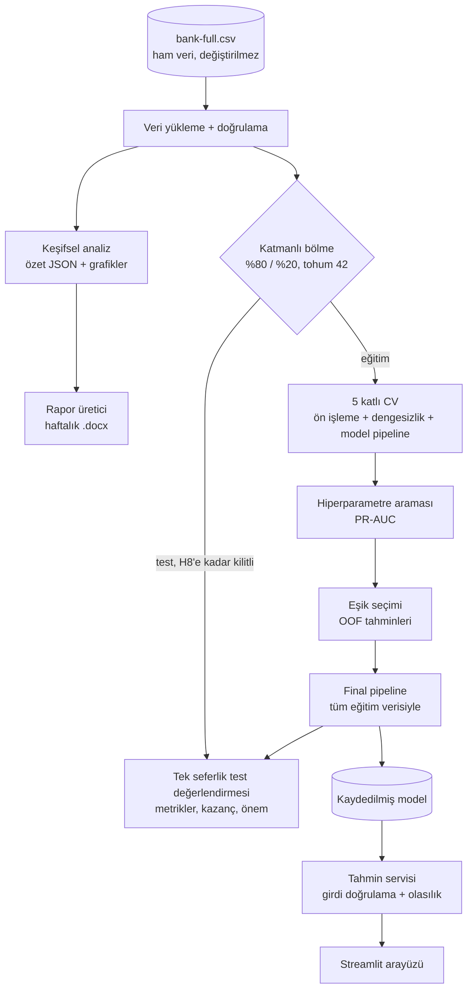

# Gereksinim Analizi Raporu — Sürüm 2

> **Proje:** Banka Pazarlama Kampanyalarına Müşteri Yanıtının Tahmini · **Ekip:** BankTech
> Ömer NARÇİÇEĞİ 230260054 · Mustafa Emre KAPLAN 230260143 · Mesut ASLAN 230260173
> İlgili belgeler: [PRD](prd.md) · [Yol Haritası](yol_haritasi.md) · [Ön İşleme Kararları](on_isleme_kararlari.md) · [Veri Sözlüğü](veri_sozlugu.md)

| Sürüm | Hafta | Değişiklik |
|---|---|---|
| 1.0 | 2 | İlk sürüm: amaç, paydaşlar, FG-1…FG-8, FOG-1…FOG-5, veri/yazılım/donanım, kısıtlar |
| 2.0 | 3 | Öncelik (MoSCoW), kabul kriteri, doğrulama yöntemi ve hedef hafta eklendi; kullanım senaryoları, sızıntı analizi, mimari, risk kaydı, izlenebilirlik matrisi ve sözlük eklendi; FG-9…FG-12 ve FOG-6…FOG-7 eklendi |

## 1. Amaç ve Kapsam

Sistem, bankanın telefonla yürüttüğü pazarlama kampanyalarında bir müşterinin vadeli mevduat teklifini kabul etme olasılığını, **arama yapılmadan önce bilinen** bilgilerden tahmin edecektir. Böylece banka aramalarını kabul ihtimali yüksek müşterilere yönlendirerek zaman ve maliyetten tasarruf edebilecektir.

**Kapsam içi:** veri doğrulama, keşifsel analiz, ön işleme, model geliştirme ve karşılaştırma, değerlendirme, açıklanabilirlik, model kaydı ve basit bir tahmin arayüzü (Streamlit).
**Kapsam dışı:** bankanın gerçek sistemlerine entegrasyon, canlı dağıtım, kullanıcı yönetimi, `duration` değişkeninin kullanımı, `bank-additional` veri sürümü (ayrıntı: [PRD › Kapsam Dışı](prd.md#kapsam-dışı)).

## 2. Paydaşlar

| Paydaş | Rol | Beklenti | İlgi / Etki |
|---|---|---|---|
| Pazarlama yöneticisi | Son kullanıcı | Arama listesini önceliklendirmek, kampanya verimini ölçmek | Yüksek / Yüksek |
| Çağrı merkezi çalışanı | Son kullanıcı | Tek müşteri için hızlı ve anlaşılır tahmin | Yüksek / Orta |
| Proje ekibi (3 üye) | Geliştirici | Tekrar üretilebilir, test edilmiş, sızıntısız bir model | Yüksek / Yüksek |
| Ders sorumlusu öğretim üyesi | Değerlendirici | Bilimsel yöntem, literatür karşılaştırması, takım çalışması kanıtı | Orta / Yüksek |
| Banka müşterileri | Dolaylı etkilenen | Gereksiz aramalarla rahatsız edilmemek | Düşük / Düşük |

## 3. Kullanım Senaryoları

| No | Senaryo | Ana akış | Alternatif akış |
|---|---|---|---|
| KS-1 | Arama listesini sırala | Yönetici müşteri listesini (CSV) modele verir; sistem her müşteriye olasılık atayıp azalan sırada döndürür | Listede geçersiz değer varsa ilgili satırlar hata nedeniyle birlikte raporlanır |
| KS-2 | Kazanç tablosu | Sistem test setinde ilk %10/%20/%30 aramanın yakaladığı kabul oranını gösterir | — |
| KS-3 | Tek müşteri tahmini | Çalışan formu doldurur → olasılık, etiket (yüksek/orta/düşük) ve karar görünür | Geçersiz girdi → alan bazında anlaşılır hata mesajı |
| KS-4 | Etkenleri gör | Arayüz kararı en çok etkileyen 3 değişkeni gösterir; raporda genel önem grafiği bulunur | — |
| KS-5 | Model geliştirme | Ekip CV ile modelleri karşılaştırır, en iyisini seçer, test setinde bir kez değerlendirip kaydeder | CV sonuçları kabul kriterini karşılamazsa özellik/strateji iterasyonu yapılır |
| KS-6 | Haftalık rapor | Kaptan analiz betiğini, sonra rapor üreticiyi `--kaptan` ile çalıştırır → .docx | Özet JSON yoksa üretici anlamlı hata verir |
| KS-7 | Yeniden üretim | Öğretim üyesi depoyu klonlar, kurulum ve testleri çalıştırır, rapordaki sayıları elde eder | — |

## 4. Fonksiyonel Gereksinimler

Öncelik: **M** = Must (olmazsa olmaz), **S** = Should (olmalı), **C** = Could (olabilir). Durum: ✓ tamamlandı, ◐ kısmen, ○ başlamadı.

| No | Gereksinim | Öncelik | Kabul kriteri | Doğrulama | Hafta | Durum |
|---|---|---|---|---|---|---|
| FG-1 | Sistem veri setini okuyup satır, sütun ve hedef değerlerini otomatik doğrulamalıdır. | M | 45.211 × 17, hedef yalnızca yes/no, 5.289 yes; farklıysa anlamlı hata | Birim testi | 2 | ✓ |
| FG-2 | `unknown` değerler ayrı kategori olarak ele alınmalı; kategorik değişkenler One-Hot, sayısal değişkenler (LR için) dönüştürülüp standartlaştırılmalıdır. | M | Pipeline çıktısında `unknown` kategorileri ayrı sütun; eğitimde görülmeyen kategori hata vermez | Birim testi | 4 | ✓ (H4, `src/preprocessing.py`) |
| FG-3 | `duration` değişkeni modele girmeden önce veriden çıkarılmalıdır. | M | Model girdisinde `duration` sütunu yok | Birim testi | 2-4 | ✓ (H4, bölme fonksiyonu + test) |
| FG-4 | Veri katmanlı olarak %80/%20 bölünmeli; SMOTE, sınıf ağırlıklandırma ve eşik ayarlama denenmeli, SMOTE yalnızca eğitim katmanlarına uygulanmalıdır. | M | Bölmede sınıf oranı ±0,5 puan içinde korunur; SMOTE doğrulama katmanının boyutunu değiştirmez | Birim testi | 4-6 | ◐ (katmanlı bölme H4) |
| FG-5 | LR, RF ve XGBoost modelleri eğitilmeli, hiperparametre optimizasyonu çapraz doğrulama ile yapılmalıdır. | M | Üç model için 5 katlı CV sonuçları; arama PR-AUC'ye göre | CV raporu | 5-7 | ○ |
| FG-6 | Modeller Precision, Recall, F1, ROC-AUC, PR-AUC ve karmaşıklık matrisi ile karşılaştırılabilmelidir. | M | Tek karşılaştırma tablosu (ortalama ± std) + karmaşıklık matrisi | Birim testi + rapor | 2, 5-8 | ◐ (metrik fonksiyonu H2, CV ortalama ± std tablosu H4) |
| FG-7 | Seçilen model kaydedilebilmeli ve yeni müşteri bilgisi girildiğinde kabul olasılığını verebilmelidir. | M | Kaydet-yükle sonrası aynı tahmin; olasılık 0-1 aralığında | Birim testi | 9 | ○ |
| FG-8 | Modelin kararını en çok etkileyen değişkenler grafiklerle gösterilebilmelidir. | S | İlk 10 değişken permutation importance grafiği + LR katsayı tablosu | Rapor incelemesi | 8 | ○ |
| FG-9 | Karar eşiği test setinden bağımsız olarak, eğitim verisinin çapraz doğrulama dışı tahminlerinden seçilmelidir. | M | Eşik seçim fonksiyonu yalnızca OOF tahminlerini alır; seçilen eşik ve kriteri raporlanır | Birim testi | 6 | ○ |
| FG-10 | Sistem olasılığa göre sıralanmış liste için kazanç (gain) / lift tablosu üretmelidir. | S | İlk %10/%20/%30 için yakalanan kabul oranı; elle hesaplanmış örnekle uyumlu | Birim testi | 8 | ○ |
| FG-11 | Tahmin servisi girdiyi doğrulamalı; geçersiz kategori veya aralık dışı değer için anlaşılır hata döndürmelidir. | M | Geçersiz alanın adı ve geçerli değerler mesajda yer alır; teknik iz gösterilmez | Birim testi | 9 | ○ |
| FG-12 | Haftalık rapor, sayıları koddan üretilen özet dosyasından alınarak ders şablonuna uygun biçimde otomatik üretilmelidir; kaptan parametre olarak verilmelidir. | S | `--kaptan` ile .docx üretilir; başlıklar, numaralı tablolar/şekiller ve JSON sayıları metinde | Birim testi | 3 | ✓ |
| FG-13 | Keşifsel analiz, değişken-hedef ilişkilerini etki büyüklüğüyle birlikte raporlamalıdır. | S | Ki-kare + Cramér's V, Mann-Whitney U + rank-biserial, IQR aykırı özeti | Birim testi | 3 | ✓ |
| FG-14 | Model, zaman sırasına göre ayrılmış son %20 kayıtta da değerlendirilip raporlanmalıdır (dönem etkisi kontrolü). | C | Rastgele ve zaman bazlı test skorları yan yana | Rapor | 8 | ○ |

## 5. Fonksiyonel Olmayan Gereksinimler

| No | Kategori | Gereksinim | Ölçüt | Hafta |
|---|---|---|---|---|
| FOG-1 | Başarım | Seçilen model referans modelin açıkça üzerine çıkmalıdır. | Test ROC-AUC ≥ 0,75 **ve** test PR-AUC ≥ 0,234 (referansın 2 katı) | 8 |
| FOG-2 | Tekrarlanabilirlik | Tüm rastgele işlemlerde sabit tohum; kütüphane sürümleri kilitli. | `random_state = 42`; `requirements.txt` sürümleri sabit; betik iki kez çalıştırıldığında özet JSON aynı | Her hafta |
| FOG-3 | Sürdürülebilirlik | Kod sürüm kontrolünde; ortak fonksiyonlar `src/` altında ve testli. | `pytest` yeşil; `src/` iş mantığında %80+ kapsam | Her hafta |
| FOG-4 | Kullanılabilirlik | Arayüz teknik bilgisi olmayan bir çalışanın kullanabileceği sadelikte olmalıdır. | Form yalnızca geçerli seçenekler sunar; ilk kullanımda yardım almadan tahmin alınabilir (ekip dışı 1 kişiyle deneme) | 9 |
| FOG-5 | Performans | Tek tahmin 1 saniyenin altında; eğitim standart dizüstü bilgisayarda çalışabilir. | Tek tahmin < 1 sn (test ile ölçülür); tam hiperparametre araması < 30 dk (8 GB RAM) | 7, 9 |
| FOG-6 | Taşınabilirlik | Betikler macOS ve Windows'ta aynı komutlarla çalışmalıdır. | İşletim sistemine özel yol yok; README komutları iki sistemde denenmiş | Her hafta |
| FOG-7 | Güvenilirlik / Hata yönetimi | Hatalar sessizce yutulmaz; kullanıcıya anlamlı mesaj gösterilir. | Eksik veri dosyası, eksik grafik, geçersiz girdi için açıklayıcı hata; boş `except` yok | Her hafta |

## 6. Veri Gereksinimleri ve Sızıntı Analizi

Veri: UCI Machine Learning Repository, Bank Marketing, `bank-full.csv` (45.211 kayıt, 17 sütun, Mayıs 2008 - Kasım 2010, tarihe göre sıralı). Kişiyi tanımlayan bilgi içermez; CC BY 4.0 lisanslıdır. Ham veri değiştirilmez.

Her değişken için temel soru şudur: **"Bu bilgi arama yapılmadan önce biliniyor mu?"** Bilinmiyorsa modele girmesi veri sızıntısıdır.

| Değişken | Grup | Arama öncesi bilinir mi? | Karar |
|---|---|---|---|
| age, job, marital, education | Demografi | Evet (müşteri kaydı) | Modelde |
| default, balance, housing, loan | Finansal | Evet (banka kaydı) | Modelde |
| contact | İletişim kanalı | Evet (aranacak numara türü) | Modelde |
| day, month | İletişim zamanı | Evet; planlanan arama tarihi olarak | Modelde |
| campaign | Bu kampanyadaki iletişim sayısı (son arama dahil) | Kısmen; arama anında "o ana kadarki + 1" bilinir | Modelde (risk düşük; tanım raporda belirtilir) |
| pdays, previous, poutcome | Önceki kampanya | Evet (geçmiş kayıt) | Modelde |
| **duration** | Görüşme süresi | **Hayır**, arama bitince öğrenilir | **Modelden çıkarıldı** |
| y | Hedef | — | Hedef |

Veri kalitesi bulguları (H2-H3): boş hücre ve tekrar eden satır yok. Eksik bilgi `unknown` olarak kodlanmıştır. `poutcome = unknown` kayıtlarının 36.954 / 36.959'u "önceden aranmamış" anlamındadır. `contact = unknown` mayıs-haziran aylarında yoğunlaşır (dönem etkisi).

## 7. Mimari ve Veri Akışı

## 8. Yazılım ve Donanım Gereksinimleri

- **Dil ve sürüm:** Python 3.12+ (3.14 ile doğrulandı).
- **Kütüphaneler** (`requirements.txt`, sürümleri sabit): pandas, NumPy, SciPy, scikit-learn, XGBoost, imbalanced-learn, Matplotlib, Seaborn, Jupyter, python-docx. H9'da Streamlit eklenecek.
- **Araçlar:** VS Code, Git + GitHub (feature branch + PR akışı), pytest.
- **Donanım:** 8 GB RAM'li standart dizüstü bilgisayar. GPU gerekmez.

## 9. Kısıtlar ve Varsayımlar

- Veri 2008-2010 yıllarında tek bir Portekiz bankasından toplanmıştır. Sonuçların günümüze ve başka bankalara aynen genellenmesi varsayılmaz.
- Veri dengesizdir (%11,70 kabul). Başarı doğruluk oranıyla değil, PR-AUC, ROC-AUC, Recall ve F1 ile ölçülür.
- Gerçek arama maliyeti ve mevduat getirisi bilinmediği için kazanç analizi oransal yapılır.
- Proje 10 haftalık takvimle yürütülür. Her hafta ilerleme raporu teslim edilir. Takım kaptanı haftalara göre değişir.
- Ekip üyelerinin aynı anda yalnızca kısıtlı süresi vardır. Bu yüzden iş paketleri haftalık ve bağımsız test edilebilir parçalara bölünmüştür.

## 10. Risk Kaydı

Olasılık (O) ve Etki (E): 1 düşük - 3 yüksek. Skor = O × E.

| No | Risk | O | E | Skor | Önlem |
|---|---|---|---|---|---|
| R-1 | Veri sızıntısı (duration, test verisine fit edilen dönüşüm, test setinde eşik seçimi) sonuçları şişirir | 2 | 3 | 6 | Pipeline içinde fit; test seti kilidi; sızıntı testleri; eşik OOF'ta |
| R-2 | Sınıf dengesizliği nedeniyle model azınlık sınıfı yakalayamaz | 3 | 2 | 6 | PR-AUC odaklı seçim; 3 dengesizlik stratejisi; eşik ayarı |
| R-3 | ROC-AUC ≥ 0,75 hedefine ulaşılamaz (duration olmadan sinyal sınırlı) | 2 | 2 | 4 | Özellik mühendisliği (yaş grubu, was_contacted_before); topluluk modelleri; hedef literatürle tutarlı |
| R-4 | Dönem etkisi (contact = unknown, ay) modelin genellemesini bozar | 2 | 2 | 4 | Zaman bazlı ek test (FG-14); hata analizi |
| R-5 | Kaptan değişimi ve iletişim kopukluğu teslimleri geciktirir | 2 | 2 | 4 | Rotasyon tablosu; rapor üreticide `--kaptan`; haftalık kontrol listesi (yol haritası) |
| R-6 | Ortam/sürüm farkları (Windows/macOS, Python sürümü) sonuçları değiştirir | 2 | 2 | 4 | Sabit sürümler; işletim sistemine özel yol yasak; README'de iki sistem için komut |
| R-7 | Depo yetkileri nedeniyle üyeler katkı gönderemez | 2 | 1 | 2 | Tüm üyeler collaborator; branch + PR akışı |
| R-8 | Hiperparametre araması dizüstü bilgisayarda çok uzun sürer | 1 | 2 | 2 | Rastgele arama ve sabit iterasyon bütçesi; `n_jobs` |

## 11. İzlenebilirlik Matrisi

| Gereksinim | Modül | Test / Kanıt | Hafta | Sorumlu İP |
|---|---|---|---|---|
| FG-1 | Veri yükleme ve doğrulama | Veri doğrulama testi | 2 | İP1 |
| FG-2, FG-3 | Ön işleme | Pipeline testleri (duration yok, unknown kategori, görülmeyen kategori) | 4 | İP2 |
| FG-4 | Ön işleme + Modeller | Katmanlı bölme testi, SMOTE yalnızca eğitim katmanı testi | 4-6 | İP2, İP4 |
| FG-5 | Modeller | CV karşılaştırma tablosu, tekrar üretilebilirlik testi | 5-7 | İP4, İP5 |
| FG-6 | Değerlendirme | Metrik testi, CV sonuç tablosu testi | 2, 5-8 | İP6 |
| FG-7 | Tahmin servisi | Kaydet-yükle tutarlılık testi | 9 | İP5 |
| FG-8 | Açıklama | Önem tablosu testi + rapor grafiği | 8 | İP7 |
| FG-9 | Değerlendirme | Eşik seçim testi (yalnızca OOF) | 6 | İP5 |
| FG-10 | Değerlendirme | Kazanç tablosu testi | 8 | İP6 |
| FG-11 | Tahmin servisi | Girdi doğrulama testleri | 9 | İP6 |
| FG-12 | Rapor üretici | Rapor üretici testleri | 3 | İP7 |
| FG-13 | Keşifsel analiz | EDA testleri | 3 | İP3 |
| FG-14 | Değerlendirme | Zaman bazlı test raporu | 8 | İP6 |
| FOG-1 | Değerlendirme | Final test raporu | 8 | İP6 |
| FOG-2 | Tümü | Betiğin iki kez çalıştırılıp JSON karşılaştırması | Her hafta | Tüm ekip |
| FOG-5 | Tahmin servisi | Süre testi (< 1 sn) | 9 | İP6 |

## 12. Sözlük

| Terim | Açıklama |
|---|---|
| Kabul oranı | Bir gruptaki müşterilerden teklifi kabul edenlerin oranı |
| Lift | Bir grubun kabul oranının genel kabul oranına oranı; 1'den büyükse grup ortalamadan daha isteklidir |
| Veri sızıntısı | Gerçek kullanımda tahmin anında bilinemeyecek bilginin modele girmesi |
| Katmanlı (stratified) bölme | Eğitim ve test kümelerinde hedef sınıf oranının korunması |
| Çapraz doğrulama (CV) | Eğitim verisinin k parçaya bölünüp her parçanın sırayla doğrulama için kullanılması |
| OOF (out-of-fold) tahmin | Bir kaydın, kendisinin eğitimde kullanılmadığı CV katmanındaki modelden aldığı tahmin |
| PR-AUC | Precision-Recall eğrisi altındaki alan; dengesiz veride ana başarı ölçütü |
| ROC-AUC | ROC eğrisi altındaki alan; 0,5 rastgele, 1,0 kusursuz ayrım |
| SMOTE | Azınlık sınıfı için sentetik örnek üreten aşırı örnekleme yöntemi |
| Cramér's V | Kategorik iki değişken arasındaki ilişkinin gücü (0-1) |
| Rank-biserial r | Mann-Whitney U testinin etki büyüklüğü (−1 ile 1 arası) |
| Permutation importance | Bir değişkenin değerleri karıştırıldığında model başarısındaki düşüş; değişkenin önemini gösterir |
| Kazanç (gain) tablosu | Olasılığa göre sıralı listenin ilk %X'i arandığında yakalanan kabullerin oranı |
