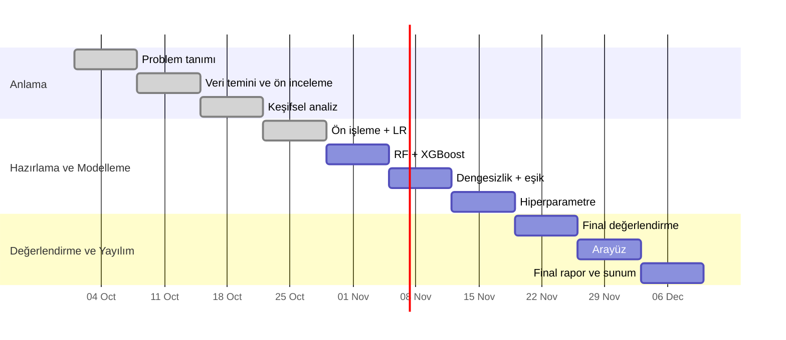

# Yol Haritası — 10 Hafta

> İlgili belgeler: [PRD](prd.md) · [Gereksinim Analizi](gereksinim_analizi.md) · [Ön İşleme Kararları](on_isleme_kararlari.md)
> Haftalık teslim günü çarşamba kabul edilmiştir (2. hafta PR'ı 14 Ekim 2026'da birleştirildi). Tarihler tahminidir; ders takvimine göre güncellenir.

## Genel Bakış

| Hafta | Tarih (tahmini) | CRISP-DM aşaması | Hedef | Durum |
|---|---|---|---|---|
| 1 | 7 Eki | İş anlama | Problem tanımı, iş paketleri, sorumlular | ✓ |
| 2 | 14 Eki | Veri anlama | Altyapı, veri temini ve doğrulama, ön inceleme, referans model | ✓ |
| 3 | 21 Eki | Veri anlama | Keşifsel analiz, istatistiksel testler, ön işleme taslağı, PRD + GA v2 + yol haritası | ✓ |
| 4 | 28 Eki | Veri hazırlama | Ön işleme pipeline'ı + ilk Lojistik Regresyon (CV) | ✓ |
| 5 | 4 Kas | Modelleme | RF ve XGBoost; üç modelin CV karşılaştırması | ○ |
| 6 | 11 Kas | Modelleme | Sınıf dengesizliği stratejileri ve eşik seçimi | ○ |
| 7 | 18 Kas | Modelleme | Hiperparametre optimizasyonu ve kalibrasyon kontrolü | ○ |
| 8 | 25 Kas | Değerlendirme | Final model seçimi, tek seferlik test, açıklanabilirlik, kazanç ve hata analizi | ○ |
| 9 | 2 Ara | Yayılım | Model kaydı, tahmin servisi, Streamlit arayüzü, güvenlik incelemesi | ○ |
| 10 | 9 Ara | Yayılım | Final raporu, sunum, demo, depo temizliği | ○ |

## Takım Kaptanı Rotasyonu

Kaptan haftalık değişebilir. Ekip bilgisi koda sabitlenmez; rapor üreticiye `--kaptan <öğrenci no>` ile verilir.

| Hafta | Kaptan | Not |
|---|---|---|
| 1 | Ömer NARÇİÇEĞİ (230260054) | |
| 2 | Mustafa Emre KAPLAN (230260143) | |
| 3 | Ömer NARÇİÇEĞİ (230260054) | |
| 4 | Ömer NARÇİÇEĞİ (230260054) | |
| 5-10 | Belirlenecek | Her hafta başında bu tabloya yazılır. Mesut ASLAN henüz kaptanlık yapmadı. |

### Kaptanın haftalık kontrol listesi

1. Hafta başında görev dağılımını bu belgedeki ilgili hafta bölümünden teyit et; değişiklik varsa tabloyu güncelle.
2. Haftanın analiz betiğini çalıştır; özet JSON ve grafiklerin üretildiğini kontrol et.
3. `pytest` çalıştır; tüm testler yeşil olmadan rapora geçme.
4. Rapor üreticiyi çalıştır: `python reports/haftaN_rapor.py --kaptan <no>`.
5. Bölüm 2 (ekip içi çalışma süreci) işaretlerini haftanın gerçek durumuna göre düzelt; her üyenin kendi bölümünü okumasını sağla.
6. Word'de aç, PDF'e aktar, `<numaralar>_haftaN.pdf` adıyla teslim et.
7. Kodu `hafta-N` branch'inden PR ile `main`'e al (`/code-review` → `/gonder`).

## Hafta Detayları

Her hafta aynı yapıdadır: **Görevler** (iş paketi sahibine göre), **Teslimler**, **Rapor Bölüm 3 kriterleri**, **Bitti tanımı**. Skill'ler: kod yazarken `karpathy-guidelines`, testler için `/test-yaz`, grafikler için `dataviz`, PR öncesi `/code-review` → `/gonder`, hata durumunda `/debug`.

### Hafta 1 — Problem Tanımı ✓
Problem, amaç ve hedefler, CRISP-DM yöntemi, iş paketleri (İP1-İP7) ve sorumlular belirlendi.

### Hafta 2 — Altyapı, Veri ve Referans Model ✓
GitHub deposu ve Python ortamı kuruldu. `bank-full.csv` indirilip testlerle doğrulandı. `unknown` ve `pdays` analizi yapıldı, `duration` çıkarıldı, referans model kuruldu (ROC-AUC 0,50; PR-AUC 0,117). Literatür taraması yapıldı. Gereksinim analizi v1 hazırlandı.

### Hafta 3 — Keşifsel Veri Analizi ✓

| Üye | Görev |
|---|---|
| Mustafa Emre KAPLAN | Kategorik değişkenlere göre kabul oranları ve grafiklerin yorumu |
| Mesut ASLAN | Sayısal dağılımlar, IQR aykırı değer analizi, Spearman korelasyonu |
| Ömer NARÇİÇEĞİ (kaptan) | Ki-kare/Cramér's V, Mann-Whitney U; ön işleme karar taslağı; PRD, GA v2, yol haritası; rapor üretici |

- **Teslimler:**
  - Keşifsel analiz modülü ve testleri
  - Özet JSON
  - 8 grafik
  - Notebook
  - Ön işleme karar taslağı
  - Haftalık rapor (.docx)
- **Bitti tanımı:** Testler yeşil; rapordaki tüm sayılar özet JSON'dan geliyor; ön işleme taslağı Hafta 4 için uygulanabilir.

### Hafta 4 — Ön İşleme Pipeline'ı ve İlk Model ✓

| Üye | Görev |
|---|---|
| Mustafa Emre KAPLAN (İP2) | Ön işleme modülü: `was_contacted_before`, yaş grubu, `pdays` dönüşümü, One-Hot (`handle_unknown="ignore"`), LR için log + ölçekleme; katmanlı bölme fonksiyonu; sızıntı testleri |
| Ömer NARÇİÇEĞİ (İP4) | 5 katlı katmanlı CV düzeni; ilk Lojistik Regresyon pipeline'ı; referans modelle karşılaştırma |
| Mesut ASLAN (İP6) | CV sonuçlarını ortalama ± std tablosuna toplayan değerlendirme fonksiyonu; PR ve ROC eğrisi grafikleri; testleri |

- **Teslimler:**
  - Ön işleme modülü ve testleri
  - LR CV sonuçları
  - PR/ROC grafikleri
  - Hafta 4 raporu
- **Rapor Bölüm 3:**
  - Ön işleme pipeline'ı kuruldu
  - Sızıntı testleri yazıldı
  - Çapraz doğrulama düzeni kuruldu
  - İlk model eğitildi
  - Model referans modelle karşılaştırıldı
- **Bitti tanımı:** Ön işleme kararlarının tamamı kodda karşılık buluyor (FG-2, FG-3, FG-4 bölme kısmı); `duration` yok testi geçiyor; LR CV PR-AUC değeri raporlandı.
- **Hafta 3'ten açık sorular:** Yaş grubu LR'yi iyileştiriyor mu? Az gözlemli aylar birleştirilmeli mi?
- **Sonuç:** Lojistik Regresyon 5 katlı CV'de PR-AUC 0,409 ± 0,011, ROC-AUC 0,770 ± 0,004 (referans model 0,117 ve 0,500). Yaş grubu küçük bir iyileşme sağladığı için tutuldu, az gözlemli aylar birleştirilmedi. Sayılar `reports/haftalik/hafta4_ozet.json` dosyasından.

### Hafta 5 — Rastgele Orman ve XGBoost

| Üye | Görev |
|---|---|
| Ömer NARÇİÇEĞİ (İP4) | RF ve XGBoost pipeline'ları (ağaçlar için ölçeklemesiz ön işleme dalı); aynı CV düzeninde eğitim |
| Mesut ASLAN (İP6) | Üç modelin karşılaştırma tablosu ve grafikleri; aynı tohumla tekrar üretilebilirlik testi |
| Mustafa Emre KAPLAN (İP2/İP3) | Ön işleme ablasyonu: `day`, yaş grubu, log dönüşümü çıkarıldığında skor değişimi |

- **Teslimler:**
  - 3 model × 5 katlı CV tablosu
  - Ablasyon sonuçları
  - Hafta 5 raporu
- **Bitti tanımı:** Üç model aynı katmanlarda ve aynı metriklerle karşılaştırıldı (FG-5'in ilk yarısı, FG-6).

### Hafta 6 — Sınıf Dengesizliği ve Eşik Seçimi

| Üye | Görev |
|---|---|
| Ömer NARÇİÇEĞİ (İP5) | Üç strateji: sınıf ağırlığı, SMOTE (imblearn pipeline içinde), ağırlıksız + eşik; 3 model × 3 strateji CV |
| Mesut ASLAN (İP6) | OOF tahminlerinden eşik seçimi fonksiyonu (F1 maksimum + hedef Recall alternatifi) ve testleri |
| Mustafa Emre KAPLAN (İP2) | "SMOTE yalnızca eğitim katmanında" testini yazmak; SMOTE ile ilgili literatür bulgularıyla sonuçları karşılaştırmak (Arifah vd. 2023) |

- **Teslimler:**
  - Strateji × model tablosu
  - Eşik seçim fonksiyonu
  - Hafta 6 raporu
- **Bitti tanımı:** FG-4 ve FG-9 tamam; eşik test setine hiç bakılmadan seçildi.

### Hafta 7 — Hiperparametre Optimizasyonu

| Üye | Görev |
|---|---|
| Ömer NARÇİÇEĞİ (İP5) | En iyi 2 model + strateji için rastgele arama (`average_precision` skoru, sabit iterasyon bütçesi); süre ölçümü (FOG-5) |
| Mesut ASLAN (İP6) | Kalibrasyon eğrisi; arama sonuçlarının görselleştirilmesi |
| Mustafa Emre KAPLAN (İP7) | Final raporu iskeleti: Hafta 1-6 bulgularının derlenmesi, literatür karşılaştırma tablosunun güncellenmesi |

- **Teslimler:**
  - Ayarlanmış modeller
  - Kalibrasyon grafiği
  - Final raporu taslak iskeleti
  - Hafta 7 raporu
- **Bitti tanımı:** FG-5 tamam; seçilecek aday model ve eşik belirlendi (henüz test setine bakılmadı).

### Hafta 8 — Final Değerlendirme ve Açıklanabilirlik

| Üye | Görev |
|---|---|
| Ömer NARÇİÇEĞİ (İP5) | Final pipeline'ı tüm eğitim verisiyle eğitmek; **test setinde tek seferlik** değerlendirme |
| Mesut ASLAN (İP6) | Karmaşıklık matrisi; kazanç/lift tablosu (FG-10); zaman bazlı ek test (FG-14) |
| Mustafa Emre KAPLAN (İP7) | Permutation importance ve LR katsayıları (FG-8); hata analizi (yanlış negatiflerin profili, `contact = unknown` dönemi) |

- **Teslimler:**
  - Final metrik tablosu
  - Kazanç tablosu
  - Önem grafikleri
  - Hata analizi
  - Hafta 8 raporu
- **Bitti tanımı:** FOG-1 karşılandı ya da karşılanmadıysa nedeni ve sonraki adım raporlandı. Literatürle karşılaştırma yapıldı (Moro vd. 2014'ün farklı veri sürümü notuyla).

### Hafta 9 — Tahmin Servisi ve Arayüz

| Üye | Görev |
|---|---|
| Ömer NARÇİÇEĞİ (İP5) | Model kaydı ve yükleme; tahmin servisi (olasılık, etiket, ilk 3 etken); kaydet-yükle tutarlılık testi |
| Mesut ASLAN (İP6) | Girdi doğrulama (geçerli kategori kümeleri, sayısal aralıklar) ve testleri; < 1 sn süre testi |
| Mustafa Emre KAPLAN (İP3/İP7) | Streamlit arayüzü (`ui-ux-pro-max` ile tasarım); ekip dışı bir kişiyle kullanılabilirlik denemesi (FOG-4) |

- **Teslimler:**
  - Çalışan arayüz
  - Tahmin servisi ve testleri
  - `/security-review` çıktısı
  - Hafta 9 raporu
- **Bitti tanımı:** FG-7 ve FG-11 tamam; arayüzde uçtan uca demo senaryosu çalışıyor; Streamlit sürümü `requirements.txt`'te sabit ve `/guncelle` ile denetlendi.

### Hafta 10 — Final Rapor, Sunum ve Demo

| Üye | Görev |
|---|---|
| Tüm ekip (İP7) | Final raporu; sunum slaytları; demo provası |
| Kaptan | README güncellemesi (kurulum, tek komutla yeniden üretim); depo temizliği; son PR |

- **Teslimler:**
  - Final raporu (PDF)
  - Sunum
  - Canlı demo
  - Temiz ve etiketlenmiş depo sürümü
- **Bitti tanımı:** PRD'deki 13 kabul kriterinin her biri için kanıt (test, tablo ya da ekran görüntüsü) final raporunda gösterildi.
